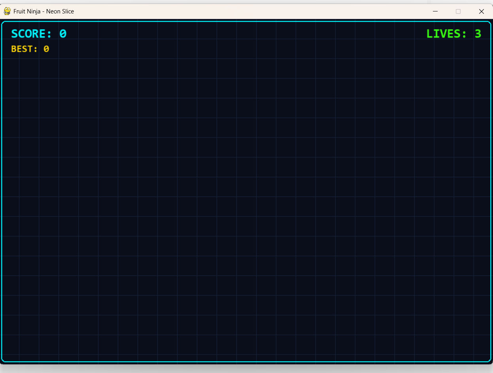

# 🍉 Fruit Ninja – Neon Slice 

**Name:** Sumaia   
**Student ID:** 11230321253  

---

## 🎮 About the Game
Fruit Ninja-Neon Slice is a fast-paced 2D arcade slicing game set in a vibrant cyberpunk neon arena. The main goal is to swipe your glowing blade to slice airborne neon fruits and collect bonus power-ups while dodging explosive bombs and preventing fruits from falling off-screen to achieve the highest possible score.

---

## 🕹️ How to Play
* **Left Mouse Button / Touchpad (Hold & Drag):** Swipe the glowing neon blade across the screen to slice fruits and power-ups while avoiding bombs.
* **Left Mouse Click / Touchpad Tap:** Click start game  on the main menu to begin or *play game* on the game-over screen to restart.
* **ESC / Close Window:** Press ESC to return to the main menu during gameplay, or close the window to exit the game.

---

## ✨ Proposed Features
* **Cyberpunk Neon Arena & HUD:** Sleek dark arcade interface featuring a glowing neon grid background, illuminated borders, and real-time tracking of **Score**, **Best Score**, and **Lives**.
* **Dynamic Neon Blade Trail:** Smooth mouse and touchpad drag-slicing mechanics with a responsive, fading neon blade trail.
* **Diverse Neon Entities:** Procedurally styled glowing fruits, hazardous bombs, and special bonus power-ups spawned in dynamic waves.
* **Parabolic Physics & Fruit Splitting:** Realistic gravity-driven upward launch and falling trajectories, continuous object rotation, and sliced fruits splitting into two halves.
* **Accurate Collision Detection:** Line-segment to circle collision detection ensuring precise hit registration between fast blade swipes and moving targets.
* **Visual Juice & Particle Effects:** Colorful particle bursts on slicing, explosive visual feedback, screen shake, screen flash, and floating combo/bonus popups.
* **Combo & Progressive Difficulty:** Multi-slice combo multipliers for rapid consecutive hits, bonus points from power-ups, and gradually faster spawn intervals as the score increases.
* **Complete Game State Management:** Smooth transitions between Start Menu, Active Gameplay, and Game Over screens, alongside automatic high score persistence in data/scores.json.
* **Immersive Audio Feedback:** Dynamic slice and explosion sound effects built with safe fallback handling.

---

## 📸 Screenshots

